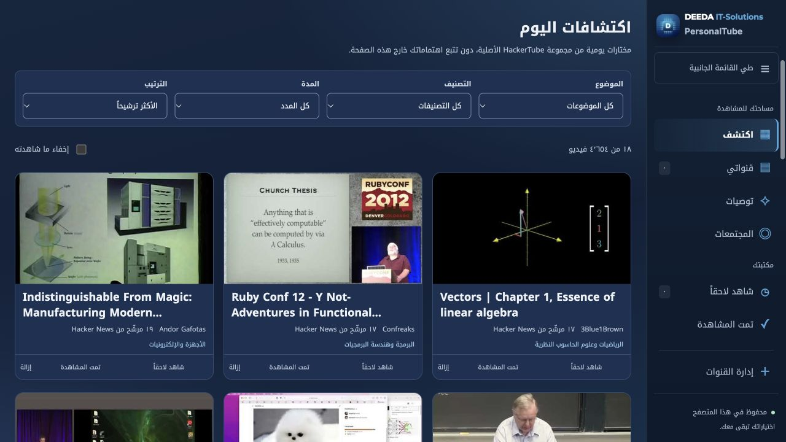
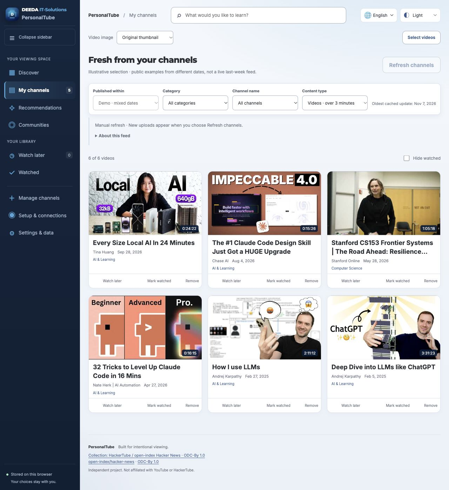

# PersonalTube

[English](README.md) · **العربية** · [Deutsch](README.de.md) · [Español](README.es.md)

**قنواتك. ترشيحات المجتمعات. ومساحة مشاهدة أنت المتحكم فيها.**

[دليل الاستخدام التفصيلي بالإنجليزية](docs/USER_GUIDE.md) · [المساهمة](CONTRIBUTING.md) · [رخصة MIT](LICENSE)

PersonalTube لوحة شخصية لتصفح فيديوهات YouTube، مبنية على **فكرة مشروع [HackerTube لأندريه كارباثي](https://karpathy.bearblog.dev/hacker-tube/) ومجموعة البيانات اللي أتاحها**. تقدر تبدأ بالمكتبة الأصلية فوراً، وتضيف قنواتك، وتبحث عن فيديوهات رشّحها الناس في نقاشات المجتمعات.




## بنينا إيه فوق شغل كارباثي؟

الفضل لفكرة اكتشاف الفيديوهات من ترشيحات تعليقات Hacker News ولمجموعة البيانات الأصلية يرجع لكارباثي وHackerTube. احتفظنا بالكتالوج والتصنيفات، وأضفنا فهرس أدلة مشتق فيه اقتباسات وروابط للمصادر وترشيحات مرتبطة. **ده تطبيق مستقل مبني على البيانات المُصدّرة، مش نسخة من كود سيرفر HackerTube الأصلي.**

الإضافات هنا بتخدم الاستخدام الشخصي المستمر:

- **قنواتك أنت:** أضف قناة بالرابط أو المعرف، وشوف منشوراتها خلال يوم لحد أسبوع.
- **فلاتر مرتبطة ببعض:** اختار «رياضة» مثلاً فتلاقي قنوات الرياضة بس. الفيديوهات الأطول من ٣ دقايق هي الافتراضي، وبعدها Shorts التقديرية أو الاتنين معاً.
- **العربي والإنجليزي والألماني والإسباني:** واجهة باتجاه مناسب لكل لغة، ووضع فاتح وداكن وتلقائي، وتصميم مرن للشاشات المختلفة. عناوين الفيديوهات والاقتباسات بتفضل بلغتها الأصلية، وأسماء مجالات وتصنيفات الكتالوج مترجمة حالياً بالعربي والإنجليزي.
- **ترشيحات بتحليل التعليقات:** اختار موضوع ومصدر؛ التطبيق يجمع العينة ويحلّلها تلقائياً ويعرض الاقتباسات الداعمة.
- **شروط واضحة للنتائج:** حد أدنى للمشاهدات والإعجابات، ولغة الصوت المعلنة، وعدد الحسابات اللي رشّحت الفيديو. النتيجة غير المتحقق منها مش بتظهر كترشيح مؤكد.
- **اختيار جهة التحليل:** اشتراك Codex أو Claude Code أو MiniMax M Plan، أو سبع خدمات API، أو نموذج محلي عبر Ollama وLM Studio وخادم محلي متوافق، مع إظهار محاولات التحليل ونتائجها.
- **تحكم في التحديث والاستهلاك:** تحديث يدوي أو تلقائي بفاصل تختاره، وعدّاد تقديري لاستخدام YouTube API.
- **مكتبة شخصية:** شاهد لاحقاً، تمت المشاهدة، إخفاء فردي أو جماعي بتأكيد، استرجاع، ونسخ احتياطي.
- **تحكم في العرض:** صورة الفيديو الأصلية أو لقطة منه، فلاتر ثابتة أثناء التمرير، وقائمة جانبية قابلة للطي.

الإضافات دي بتوضح قيمة PersonalTube، مش ادعاء إن النسخة الحالية من HackerTube مفيهاش أي ميزة مشابهة. HackerTube مناسب للبداية السريعة من موقع جاهز؛ PersonalTube أنسب لو عايز لوحة محلية قابلة للضبط ومستعد تجهز المتطلبات الاختيارية للبحث المباشر.

## قنواتك أنت



الصورة عينة توضيحية بفيديوهات من تواريخ مختلفة، مش تحديث مباشر لآخر أسبوع. الاستخدام العادي بيعرض الفترة اللي تختارها من يوم لسبعة أيام. [مصادر الأمثلة](docs/REPOSITORY_PRESENTATION.md).

## تختار التحليل إزاي؟

شاشة **الاتصالات** بقت خمس أقسام: اشتراك، API سحابي، نموذج محلي، YouTube، والاستهلاك والمساعدة. الخدمة المختارة ظاهرة فوق. من **اشتراك ← اختار حسابك واعرف طريقة ربطه** تشوف خطوات الخدمة اللي عندك؛ اختيار الاسم مش بيبدّل التحليل أو يستهلك رصيد. **MiniMax اختياري داخل «إضافة اشتراك آخر»؛ مش محتاج يكون عندك حساب فيه.**

مش كل اشتراك دردشة ينفع يتربط تلقائيًا. دخول Antigravity الشخصي مش مدعوم للتطبيقات الخارجية حسب توضيح Google، وCopilot لسه مش مدمج، واشتراك Kimi Code مش متاح لمسار التحليل الآلي ده. [إيه المدعوم وإيه حدوده؟](docs/CONNECTION_CATALOG.md)

**اشتراك MiniMax M Plan:** افتح «الاتصالات ← اشتراك ← إضافة اشتراك آخر ← MiniMax»، واحفظ مفتاح الاشتراك `sk-cp-…`، وبعدها اختبر بعينة واحدة. الحفظ والاختبار مش بيغيّروا اختيارك أو تسجيل دخول Codex وClaude؛ زر «استخدم MiniMax» هو اللي بيختاره للتحليل. مفيش تحويل للدفع حسب الاستخدام، لكن MiniMax ممكن يستهلك حِزم Credits الموجودة بعد نفاد الحصة. اختبار حساب MiniMax الحقيقي لسه محتاج مفتاحك داخل التطبيق. [خطوات الربط وحدوده](docs/MINIMAX_SUBSCRIPTION.md).

| الطريقة | المتطلبات |
|---|---|
| اشتراك Codex أو Claude Code | الأداة الرسمية المدعومة وحسابك؛ أزرار دخول وخروج واضحة، والخروج بتأكيد لأنه بيأثر على نفس تسجيل دخول الأداة. |
| اشتراك MiniMax M Plan | مفتاح الاشتراك العالمي؛ حفظ واختبار منفصلان عن اختيار الخدمة، مع توضيح حِزم Credits. |
| OpenAI وAnthropic وGemini وDeepSeek وMistral وGroq API | مفتاحك ومعرّف النموذج؛ فاتورة API منفصلة عن الاشتراك، مع إقرار بالتكلفة قبل الإعداد. |
| OpenRouter | مفتاح الخدمة ومعرّف نموذج متوافق، سواء مغلق أو مفتوح الأوزان. |
| Ollama أو LM Studio أو خادم محلي متوافق مع OpenAI | نموذج LLM أو SLM مناسب؛ زر «اعرض النماذج المتاحة» يجيب قائمة الخادم بدون تنزيل أو تشغيل تحليل. |

من **الإعداد والاتصالات ← اشتراك أو API سحابي أو نموذج محلي** تختار الخدمة. المفاتيح بتفضل في ذاكرة الخادم لحد إزالتها أو إيقافه، ومش بتدخل النسخ الاحتياطية. **اختبار بعينة واحدة** خطوة منفصلة وممكن تتكلف على الخدمات السحابية. مفيش تحويل تلقائي لخدمة تانية. [الدليل الكامل وحدود الدعم](docs/ANALYSIS_PROVIDERS.md).

## تشغّله إزاي؟

1. ثبّت [Node.js 22 أو 24](https://nodejs.org/en/download) مع npm، واستخدم متصفح حديث على كمبيوتر. الكود يعلن Node.js 20 كحد أدنى، والفحص على GitHub يستهدف 22 و24.
2. من GitHub اختار **Code → Download ZIP** وفك الضغط، وافتح Terminal داخل المجلد. أو نزّل بـGit:

```sh
git clone https://github.com/nasreldinali/Personal-Tube.git
cd Personal-Tube
```

3. شغّل:

```sh
npm start
```

افتح **[http://127.0.0.1:4173](http://127.0.0.1:4173)** وسيب نافذة Terminal مفتوحة. للإيقاف اضغط **Ctrl+C**. مش محتاج `npm install` أو قاعدة بيانات أو استضافة. اختيارياً، `npm run open` بيبدأ التشغيل ويفتح المتصفح؛ وعلى macOS فيه ملف **Start PersonalTube.command**.

لو GitHub بيعرض **404 / Repository not found**، اتأكد إن الريبو عام أو إنك داخل بحساب عنده صلاحية للريبو الخاص. لو ظهر إن **المنفذ 4173 مستخدم**، افتح العنوان الأول: ممكن التطبيق شغّال بالفعل؛ وإلا أوقف الخادم اللي مستخدم المنفذ وجرب تاني. لو `npm` مش موجود، ثبّت Node مع npm وافتح Terminal من جديد. ولو `package.json` مش موجود، افتح Terminal داخل مجلد المشروع اللي فكّيت ضغطه.

راجع [نتيجة اختبار نسخة GitHub النظيفة](docs/FIRST_RUN_VERIFICATION.md): التشغيل والتحليل اتجربوا فعليًا، مع توضيح الفرق بين استخدام حساب متصل وتجربة تسجيل دخول لأول مرة.

التصميم بيتكيف مع الموبايل والتابلت، لكن ده **مش تطبيق موبايل مستقل**: السيرفر لازم يشتغل محلياً، ومش متاح افتراضياً لأجهزة تانية على الشبكة.

## هيكلفني إيه؟

**YouTube Data API مجاني ضمن الحصة اليومية، وPersonalTube مش بيضيف رسوم API.** الحصة الافتراضية الحالية هي ١٠ آلاف وحدة لطلبات البيانات، ومعاها حد منفصل ١٠٠ طلب بحث عن فيديو يومياً. بتتجدد عند منتصف الليل بتوقيت المحيط الهادئ؛ حدود مشروعك ممكن تختلف. [جدول Google الرسمي](https://developers.google.com/youtube/data/determine_quota_cost).

الاستخدام الشخصي المعتدل ممكن يناسب الحصة بسهولة، لكن مش بنضمن إنها تكفي أي استخدام. مثال توضيحي: ٢٠ قناة × ٤ تحديثات يومياً × طلبين لكل قناة ≈ ١٦٠ وحدة. صفحات إضافية وبحث وتعليقات ومحاولات تانية أو تطبيقات بتشارك نفس المشروع بتزوّد الاستهلاك. تقدر تختار تحديث يدوي أو فاصل أطول. **المشاهدة نفسها مش بتستهلك حصة Data API**، وعند نفاد الحصة الطلبات الجديدة بتتوقف؛ التطبيق مش بيشتري حصة إضافية تلقائياً.

**تحليل التعليقات اختياري ومنفصل:** تختار اشتراكك في Codex/ChatGPT أو Claude Code أو MiniMax M Plan، أو API بمفتاحك وفاتورته المنفصلة، أو نموذج محلي على جهازك. إعداد API محتاج إقرار بالتكلفة؛ اختبار الاتصال نفسه ممكن يتكلف. مفيش تحويل تلقائي لخدمة تانية ولا وعد بتحليل مجاني بلا حدود. المكتبة الأصلية مش محتاجة أي اتصال تحليل.

## محتاج حسابات أو اشتراكات؟

| عايز تعمل إيه؟ | المطلوب |
|---|---|
| تتصفح المكتبة الأصلية، تبحث فيها، تحفظ فيديوهات وتشغّل المتاح منها | Node.js ومتصفح فقط؛ بدون مفتاح API أو حساب تحليل |
| تضيف قنوات وتجيب فيديوهاتها الحديثة أو مدد الفيديوهات الناقصة | مفتاح YouTube Data API خاص بيك |
| تبحث عن توصيات بتحليل تعليقات YouTube أو المجتمعات مباشرة | مفتاح YouTube واتصال تحليل مدعوم تختاره بنفسك |
| تستورد ملف جاهز فيه روابط فيديوهات | ملف مطابق للتنسيق؛ الاستيراد نفسه مش بيعمل تحليل تلقائي |

**محدش بيستخدم رصيد صاحب المشروع.** كل واحد بيستخدم مفتاحه واشتراكه أو نموذجه المحلي. التطبيق مفيهوش رصيد مشترك أو نموذج مدمج؛ التعليقات العامة المختارة بتروح لاتصال التحليل اللي اخترته، بحدوده وتكلفته.

افتح **«الإعداد والاتصالات»** لتجهيز المزايا الإضافية. مفتاح Google لازم تكون خدمة **YouTube Data API v3** مفعّلة له، ويتقيّد بالخدمة وعنوان الموقع المحلي. أضفه في **«الإعدادات والبيانات»**، مش داخل ملفات المشروع.

لو اخترت التحليل باشتراك Codex أو Claude Code، لازم تثبّت أداة CLI المحلية وتسجّل دخولك، مش مجرد امتلاك الاشتراك. الإصدارات المقبولة حالياً **Codex CLI 0.155.1** أو **Claude Code 2.1.281**؛ غيرها مرفوض لحد مراجعة طريقة تشغيله. التطبيق مش بيثبّتهم تلقائياً. [دليل الربط لأول مرة خطوة بخطوة](docs/ANALYSIS_SETUP.md). الشاشة بتفرّق بين «الحساب متصل» و«التحليل نجح». اختبارات حالات الربط نجحت ببيانات تجريبية؛ إكمال الدخول الفعلي بحساب جديد لسه محتاج صاحب الحساب يعمل الخطوة الرسمية ويجرّب طلب تحليل.

أما MiniMax وخيارات API وOllama وLM Studio فمش محتاجة Codex أو Claude Code. [دليل كل طرق الربط وحدودها](docs/ANALYSIS_PROVIDERS.md). مفاتيح التحليل بتفضل في ذاكرة الخادم المحلي فقط لحد إغلاقه أو إزالة الاتصال، ومش بتتحفظ في ملفات المشروع أو النسخ الاحتياطية.

## تبدأ منين؟

- **اكتشف:** ٤٬٦٥٤ فيديو موصى به وغير إخباري مختارين من تصدير فيه ٦٬٤٥٤ فيديو، و١٦ مجال و١٥٠ تصنيف.
- **قنواتي:** تابع اختيارك الشخصي وحدد مدة النشر والتصنيف والقناة ونوع المحتوى.
- **توصيات / المجتمعات:** ابحث بموضوع في تعليقات YouTube أو Hacker News أو Stack Exchange أو Reddit باتصال مصرح به. بحث المجتمعات يبدأ بحد ١٠٠ ألف مشاهدة وألف إعجاب وترشيحات من حسابين مختلفين، وتقدر تغيّر الشروط.
- **مكتبة HackerTube الأصلية:** جاهزة بدون تحليل جديد، مع ترتيبها وأدلتها الأصلية.

الدرجة الأصلية للمجتمع مش تقييم نجوم ولا عدد مشاهدات. التحليل ممكن يغلط، وكثرة المشاهدات أو الحسابات مش إثبات لأصالة التعليقات. لو العينة مش محققة الشروط، ممكن متظهرش نتائج.

## حدود مهمة قبل الاستخدام

- عدّاد API **تقديري داخل المتصفح**، مش رصيد مشروعك الفعلي عند Google. تشغيل الفيديو نفسه مش طلب Data API؛ جلب البيانات والبحث والتعليقات بيستهلكوا الحصة.
- المفتاح بيتحفظ مؤقتاً افتراضياً، والحفظ الدائم اختياري. التخزين مش مشفّر من التطبيق، والنسخ الاحتياطية لا تشمل المفاتيح أو كاش API.
- Shorts تصنيف تقديري حسب المدة، وقد يشمل فيديوهات عادية قصيرة. جلب القنوات محدود بـ٢٥٠ منشور لكل قناة مع تنبيه لو العينة ناقصة.
- استيراد Hugging Face وKaggle وCommon Crawl وWikipedia والأرشيفات محتاج ملف جاهز؛ دي مش محركات بحث أو زواحف تلقائية لكل قواعد البيانات.
- YouTube Premium داخل المشغل بيعتمد على حسابك والمتصفح؛ مفيش ضمان مطلق لغياب الإعلانات.
- البيانات الشخصية محلية، لكن الصور والتشغيل وطلبات Google والتحليل اتصالات خارجية. التطبيق مش شغال بالكامل بدون إنترنت.
- السيرفر مصمم للاستخدام المحلي الفردي، ومش جاهز للاستضافة العامة بدون تصميم أمني إضافي.

## المساهمة والرخصة

ابدأ من [مهام المبتدئين](https://github.com/nasreldinali/Personal-Tube/labels/good%20first%20issue)، واقرأ [دليل المساهمة](CONTRIBUTING.md). الفحص الكامل:

```sh
npm run check
```

الكود متقسم حسب الوظيفة: إدارة القنوات، المشغّل، الإعدادات، المكتبة، الفلاتر والتحديث. التنسيقات متقسمة مع الحفاظ على ترتيبها، والاختبارات بتراجع سلوك الاستخدام وحماية البيانات. [خريطة الصيانة وطريقة التحقق](docs/FRONTEND_CLEANUP.md).

شكر خاص لأندريه كارباثي و[HackerTube](https://hackertube.org/) على الفكرة والتصدير. PersonalTube مشروع مستقل بهوية DEEDA، وغير تابع رسمياً لكارباثي أو HackerTube أو YouTube.

الكود والتوثيق الأصليان لـPersonalTube برخصة [MIT](LICENSE). البيانات الخارجية تحت شروطها، والخطوط تحت SIL OFL، وهوية DEEDA مش مرخصة لإعادة الاستخدام العام. راجع [NOTICE.md](NOTICE.md) قبل توزيع نسخة مشتقة. [سياسة الأمان](SECURITY.md) · [نتائج الفحص](docs/VERIFICATION.md).
