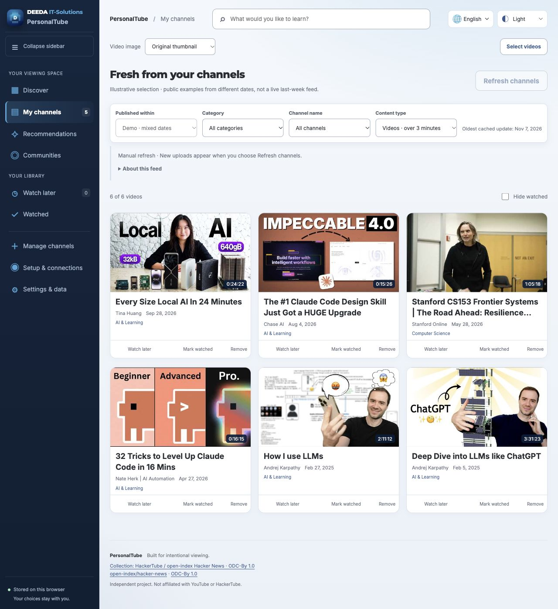

# PersonalTube

**Deine Kanäle, Empfehlungen aus Diskussionen und eine Videobibliothek unter deiner Kontrolle.**

[English](README.md) · [العربية](README.ar.md) · **Deutsch** · [Español](README.es.md)

PersonalTube ist ein lokales YouTube-Dashboard auf Grundlage von Andrej Karpathys [HackerTube-Idee](https://karpathy.bearblog.dev/hacker-tube/) und dem bereitgestellten Datenexport. Es verwendet den Katalog, nicht den ursprünglichen Anwendungscode von HackerTube. Diese Einführung ist auf Deutsch; die ausführlichen technischen Anleitungen sind überwiegend auf Englisch.



*Illustrative Auswahl aus unterschiedlichen Veröffentlichungszeiträumen. Im normalen Betrieb zeigt der Feed das gewählte Fenster von 1–7 Tagen.*

## Starten

1. [Node.js 22 oder 24](https://nodejs.org/en/download) mit npm installieren.
2. Dieses Repository über **Code → Download ZIP** herunterladen und entpacken. Ein privates Repository erfordert Zugriffsrechte. Alternativ:

```sh
git clone https://github.com/nasreldinali/Personal-Tube.git
cd Personal-Tube
```

3. Ein Terminal im Projektordner öffnen und starten:

```sh
npm start
```

4. [http://127.0.0.1:4173](http://127.0.0.1:4173) im Browser öffnen. Das Terminal geöffnet lassen; mit **Ctrl+C** beenden.

Kein `npm install`, Build oder Datenbankserver ist erforderlich. `index.html` nicht direkt öffnen. Die Oberfläche passt sich kleinen Bildschirmen an; der lokale Server ist jedoch nur auf demselben Computer erreichbar.

## Was ist möglich?

- Die enthaltene HackerTube-Bibliothek durchsuchen, Videos speichern und verfügbare Videos abspielen – ohne Analyse-Konto.
- Eigene Kanäle hinzufügen und nach Kategorie, Kanal, Zeitraum sowie Videos oder geschätzten Shorts filtern.
- Kommentare zu einem Thema aus unterstützten Quellen sammeln und automatisch analysieren; passende Empfehlungen mit belegenden Zitaten anzeigen.
- Manuelle oder zeitgesteuerte Aktualisierung wählen und den geschätzten YouTube-API-Verbrauch sehen.
- Englisch, Arabisch, Deutsch oder Spanisch sowie helles, dunkles oder Systemdesign wählen. Videotitel und Zitate bleiben in der Originalsprache; Katalogkategorien sind derzeit Englisch/Arabisch.

## Verbindungen und Kosten

| Funktion | Voraussetzung |
|---|---|
| Enthaltene Bibliothek | Node.js und Browser |
| Neue Kanaldaten und Live-Suche | Eigener YouTube-Data-API-Schlüssel |
| Analyse per Abonnement | Unterstützte Codex- oder Claude-Code-CLI und eigenes berechtigtes Konto |
| Cloud-Analyse | Eigener OpenAI-, Anthropic- oder OpenRouter-Schlüssel und kompatible Modell-ID |
| Lokale Analyse | Laufendes Ollama oder LM Studio mit einem geeigneten lokalen Modell |

In **Setup & connections** zwischen Abonnement, Cloud-API und lokalem Modell wählen. Die Auswahl der Ansicht allein wechselt den aktiven Dienst nicht. **Mit einem Beispiel testen** prüft die gewählte Verbindung nach Bestätigung.

Die YouTube Data API ist innerhalb ihrer Kontingente kostenlos. Aktualisierungen, Suchanfragen und Metadaten verbrauchen Kontingent; die Wiedergabe selbst nicht. Der Zähler ist eine Schätzung dieses Browsers, kein offizieller Kontostand. Analyse kann Abonnementkontingent oder separate API-Kosten verursachen. Lokale Modelle benötigen eigene Hardware. Niemand nutzt Guthaben des Projektinhabers; es gibt keinen automatischen Wechsel zu einer kostenpflichtigen API.

Analyse-API-Schlüssel bleiben nur im Arbeitsspeicher des lokalen Servers. Ein Serverneustart entfernt diese Verbindungen. YouTube-Schlüssel liegen standardmäßig im Sitzungsspeicher des Browsers; dauerhaftes Merken ist optional. Backups enthalten keine Schlüssel.

[Verbindungsanleitung](docs/ANALYSIS_PROVIDERS.md) · [Benutzerhandbuch](docs/USER_GUIDE.md) · [Tests](docs/VERIFICATION.md) · [Mitwirken](CONTRIBUTING.md)

## Grenzen und Lizenz

Automatische Empfehlungen können falsch sein. Shorts werden anhand der Dauer geschätzt. YouTube Premium wird im eingebetteten Player nicht garantiert. Der Server ist für einen lokalen Nutzer gedacht und darf ohne zusätzliche Sicherheitsarchitektur nicht öffentlich bereitgestellt werden.

PersonalTube-Code und Dokumentation: [MIT](LICENSE). Der HackerTube/open-index-Katalog behält seine ODC-By-1.0-Bedingungen; Schriften und DEEDA-Markenmaterial haben eigene Hinweise. Siehe [NOTICE](NOTICE.md). PersonalTube ist ein unabhängiges Projekt, kein offizielles Produkt von Karpathy oder YouTube.
