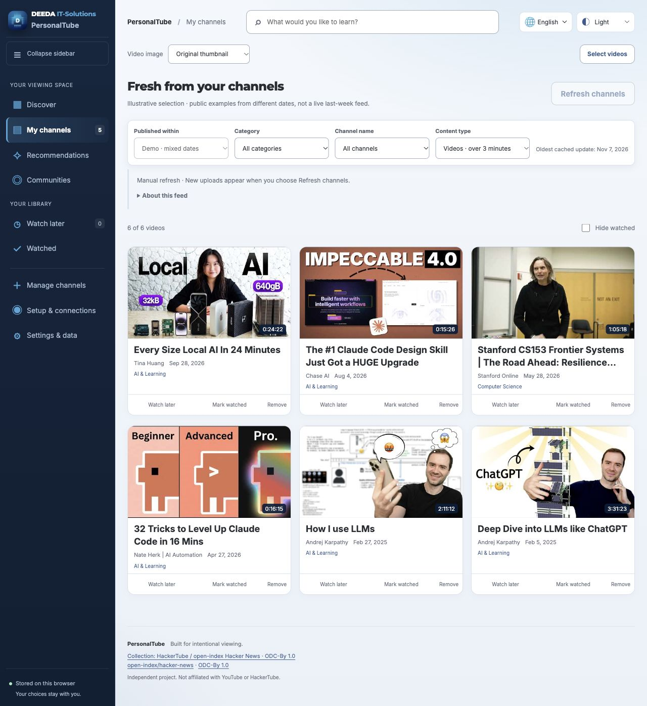

# PersonalTube

**Tus canales, recomendaciones de comunidades y una biblioteca de vídeos que tú controlas.**

[English](README.md) · [العربية](README.ar.md) · [Deutsch](README.de.md) · **Español**

PersonalTube es un panel local de YouTube basado en la [idea de HackerTube de Andrej Karpathy](https://karpathy.bearblog.dev/hacker-tube/) y su colección exportada. Utiliza el catálogo, no el código original de la aplicación HackerTube. Esta introducción está en español; las guías técnicas detalladas están principalmente en inglés.



*Selección ilustrativa de vídeos de distintas fechas. El uso normal muestra el periodo elegido de 1–7 días.*


## Empezar

1. Instala [Node.js 22 o 24](https://nodejs.org/en/download) con npm.
2. Descarga el repositorio con **Code → Download ZIP** y descomprímelo. Un repositorio privado requiere permiso de acceso. También puedes usar:

```sh
git clone https://github.com/nasreldinali/Personal-Tube.git
cd Personal-Tube
```

3. Abre una terminal en la carpeta del proyecto y ejecuta:

```sh
npm start
```

4. Abre [http://127.0.0.1:4173](http://127.0.0.1:4173) en el navegador. Mantén abierta la terminal; usa **Ctrl+C** para detenerlo.

No requiere `npm install`, compilación ni base de datos. No abras `index.html` directamente. La interfaz se adapta a pantallas pequeñas, pero el servidor local solo es accesible desde el mismo equipo.

## ¿Qué puedes hacer?

- Explorar la biblioteca incluida de HackerTube, guardar vídeos y reproducir los disponibles sin una cuenta de análisis.
- Añadir tus canales y filtrar por categoría, canal, fecha, vídeos o Shorts estimados.
- Recopilar comentarios sobre un tema de fuentes compatibles y analizarlos automáticamente; ver recomendaciones con citas que las respaldan.
- Elegir actualización manual o programada y consultar una estimación del uso de YouTube API.
- Usar inglés, árabe, alemán o español y apariencia clara, oscura o del sistema. Los títulos y citas conservan su idioma; las categorías del catálogo están actualmente en inglés/árabe.

## Conexiones y costes

**Conexiones sigue un orden claro: tipo de conexión → servicio → conectar, probar o gestionar.** Suscripción, API en la nube y modelo local muestran solo sus servicios. El selector de suscripción muestra una cuenta a la vez; explorar opciones no cambia la cuenta activa ni inicia sesión o pruebas. La cuenta activa sigue visible arriba. La guía de compatibilidad está en **Uso y ayuda**; MiniMax es una opción del selector de suscripciones.

**GitHub Copilot:** instala CLI 1.0.107, inicia sesión desde la app, prueba una muestra y selecciónalo explícitamente. El inicio de sesión y la prueba mantienen el servicio activo y las sesiones de Codex/Claude. Usa tu cuota GitHub sin alternativa API; desactiva los excesos de pago en GitHub. Aún no se ha verificado aquí un análisis con una cuenta real de Copilot. [Configuración y límites](docs/COPILOT_SUBSCRIPTION.md).

**Settings & data** comparte la navegación fija de Connections: YouTube, uso de API, actualizaciones y copias/datos.

**MiniMax M Plan:** En **Setup & connections → Subscription → MiniMax**, guarda tu clave de suscripción (`sk-cp-…`) y prueba una muestra. Guardar/probar no cambia el proveedor seleccionado ni las sesiones de Codex/Claude. **Use MiniMax** lo selecciona explícitamente. Sin alternativa de pago por uso; MiniMax puede consumir paquetes de créditos existentes al agotar la cuota. Falta verificar una cuenta real. [Configuración y límites](docs/MINIMAX_SUBSCRIPTION.md).

| Función | Requisito |
|---|---|
| Biblioteca incluida | Node.js y navegador |
| Nuevos datos de canales y búsqueda en directo | Tu propia clave de YouTube Data API |
| Suscripción MiniMax M Plan | Tu clave global de suscripción; sin CLI. Cuota y después posibles paquetes de créditos existentes. |
| GitHub Copilot | CLI oficial 1.0.107, inicio de sesión GitHub y prueba antes de seleccionarlo |
| Suscripción Codex/Claude | CLI compatible de Codex o Claude Code y tu cuenta elegible |
| Análisis en la nube | Tu clave de OpenAI, Anthropic, OpenRouter, Gemini, DeepSeek, Mistral o Groq y un ID de modelo compatible |
| Análisis local | Ollama, LM Studio o un servidor local compatible ejecutándose con un modelo local adecuado |

En **Setup & connections**, elige suscripción, API en la nube o modelo local. Cambiar de sección no cambia por sí solo el servicio activo. **Probar con una muestra** comprueba la conexión seleccionada tras confirmarlo.

YouTube Data API es gratuita dentro de sus cuotas. Actualizar datos, buscar y obtener metadatos consume cuota; reproducir el vídeo no. El contador es una estimación del navegador, no el saldo oficial. El análisis puede consumir cuota de una suscripción o generar costes de API independientes. Los modelos locales requieren tu propio hardware. Nadie utiliza el crédito del propietario del proyecto y no hay cambio automático a una API de pago.

Las claves de análisis solo permanecen en la memoria del servidor local. Al reiniciarlo se eliminan esas conexiones. Las claves de YouTube se guardan por defecto en la sesión del navegador; recordarlas de forma persistente es opcional. Las copias de seguridad no incluyen claves.

[Guía de conexiones](docs/ANALYSIS_PROVIDERS.md) · [Manual de uso](docs/USER_GUIDE.md) · [Pruebas](docs/VERIFICATION.md) · [Contribuir](CONTRIBUTING.md)

## Límites y licencia

El análisis automático puede equivocarse. Los Shorts se estiman por duración. YouTube Premium no está garantizado dentro del reproductor integrado. El servidor es para un usuario local y no debe publicarse en internet sin un diseño de seguridad adicional.

Código y documentación de PersonalTube: [MIT](LICENSE). El catálogo HackerTube/open-index conserva sus condiciones ODC-By 1.0; las fuentes y la marca DEEDA tienen avisos propios. Consulta [NOTICE](NOTICE.md). PersonalTube es independiente y no es un producto oficial de Karpathy ni de YouTube.

La nueva vista **Connections** separa suscripción, API en la nube, modelo local, YouTube y uso/ayuda. **Find available models** lee la lista del servidor local sin analizar ni descargar modelos. Los LLM y SLM pequeños necesitan una salida JSON adecuada. No toda suscripción de chat permite integración: Google no admite sesiones personales de Antigravity en apps externas; Copilot está integrado mediante su CLI oficial, y Kimi Code no se ofrece para este flujo automático. [Compatibilidad y límites](docs/CONNECTION_CATALOG.md).

En **Suscripción → Encontrar mi cuenta o suscripción**, elige tu servicio para ver la vía disponible. Elegir un nombre no inicia sesión, cambia el proveedor ni consume cuota de análisis.
