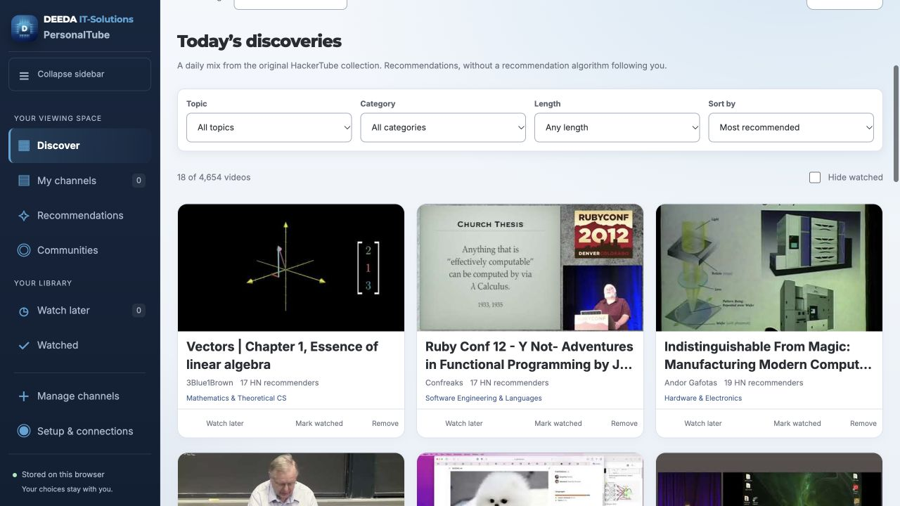
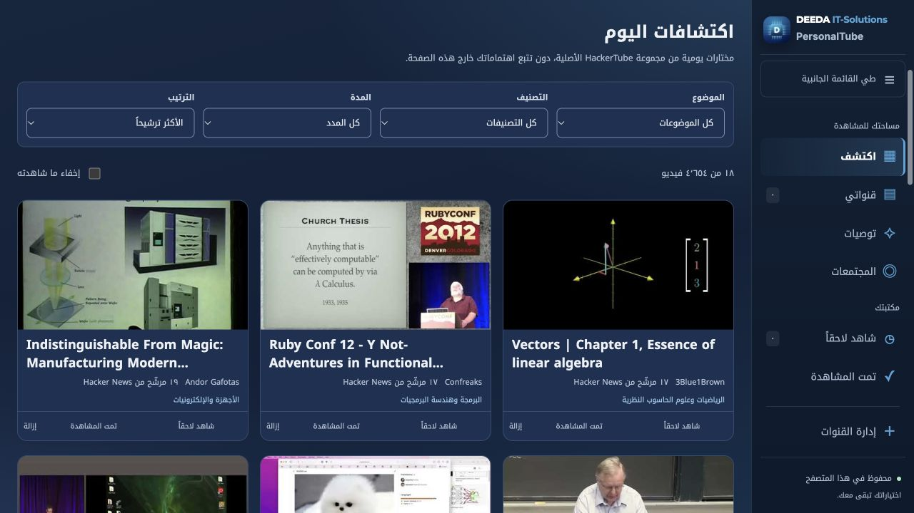

# PersonalTube

**Your channels. Community recommendations. A viewing space you control.**

[](package.json)
[](#quick-start)
[](LICENSE)
[](README.ar.md)

[العربية](README.ar.md) · [User guide](docs/USER_GUIDE.md) · [Contributing](CONTRIBUTING.md) · [Checks](https://github.com/nasreldinali/Personal-Tube/actions/workflows/check.yml)

PersonalTube is a local YouTube dashboard built on **Andrej Karpathy’s [HackerTube](https://karpathy.bearblog.dev/hacker-tube/) idea and exported collection**. Browse the original recommendations immediately, follow your own channels, and discover videos through public community discussions—with English/Arabic controls, adjustable quality filters and control over refresh usage.



<details>
<summary>See the Arabic interface in dark mode</summary>



</details>

## What this adds to the HackerTube foundation

Karpathy’s work supplies the starting idea: discover YouTube videos through recommendations in Hacker News comments. This repository retains the supplied catalog and taxonomy, and includes a derived evidence index with source links and related recommendations. **It uses the data export, not HackerTube’s original application or server code.**

PersonalTube adds a workflow for ongoing personal use:

| Addition | Why it helps |
|---|---|
| Your own channel feed | Add channels by handle, URL or ID; see uploads from the last 1–7 days. No source-file editing. |
| Connected filters | Pick a category, then only its channels. Choose long videos, estimated Shorts, or both. |
| English + Arabic | Translated controls and taxonomy, full right-to-left layout, light/dark/system themes and responsive cards. Source titles and quotes keep their original language. |
| Live community discovery | Choose a topic and source; collect and analyze the selected comments automatically, with progress and supporting quotes. |
| Visible recommendation requirements | Adjust minimum views/likes, declared audio language and endorsement count. Unverified results are withheld. |
| Your choice of analysis provider | Use a supported local Codex or Claude Code subscription login. Each user supplies their own account. |
| Refresh and usage controls | Manual or scheduled channel refresh, selectable intervals and an explicitly estimated daily YouTube API counter. |
| Personal library controls | Watch later, watched history, confirmed single/bulk hiding, restore, category management and portable backups. |
| A choice of video images | Original thumbnail or a video-frame image; sticky filters and a collapsible sidebar. |

These are PersonalTube capabilities, not a claim that the current HackerTube lacks every comparable feature. HackerTube is the simpler hosted starting point; PersonalTube is for people who want a configurable local dashboard and accept optional setup for live features.

## Quick start

### 1. Install Node.js

Use [Node.js 22 or 24](https://nodejs.org/en/download), with npm, and a modern browser. The code declares Node.js 20 as its minimum; the contribution workflow checks 22 and 24. Start with a desktop or laptop. The layout adapts to tablets and phones, but this is **not a standalone mobile app** and the local server is not exposed to other devices.

### 2. Download the project

Choose **Code → Download ZIP** on GitHub and extract it, or clone it:

```sh
git clone https://github.com/nasreldinali/Personal-Tube.git
cd Personal-Tube
```

For a ZIP download, open a terminal inside the extracted folder.

### 3. Start it

```sh
npm start
```

Open **[http://127.0.0.1:4173](http://127.0.0.1:4173)** and keep that terminal open. Stop with **Ctrl+C**. There is no `npm install` step, build step, database or cloud hosting to configure.

Optional: `npm run open` starts the server and opens a browser; on macOS it tries Chrome. macOS also has **Start PersonalTube.command**. Do not open `index.html` directly.

## What do I need for each feature?

| Feature | YouTube API key | Analysis account |
|---|---|---|
| Browse/search the included HackerTube library, save videos and play available embeds | No | No |
| Follow channels, fetch recent uploads or load missing durations | Your own key | No |
| Find recommendations with analyzed YouTube comments | Your own key | Your own supported Codex or Claude Code login |
| Search live communities with verified video statistics | Your own key | Your own supported Codex or Claude Code login |
| Import a prepared video-link file | No for import | No for import; it does not automatically classify the file |

**Downloading this repository never gives someone access to the maintainer’s API key or subscription.** Each installation uses its own browser key and local analysis account. Analysis consumes that account’s allowance; the app does not sell credits, bundle a model, or provide a shared analysis service. Public comments are sent to the selected provider, so analysis is not fully offline.

For live features, open **Setup & connections**. Create a key with **YouTube Data API v3** enabled, restrict it to that API and the local website origin, then enter it in **Settings & data**. Install/sign in to your chosen analysis CLI separately if needed; PersonalTube does not install it for you. The app currently accepts **Codex CLI 0.155.1** and **Claude Code 2.1.281** only; other versions are refused until their execution policies are reviewed. A paid account alone does not replace the local CLI requirement. See the [setup guide](docs/USER_GUIDE.md#first-run-setup).

## Three ways to find something worth watching

- **Discover:** start with 4,654 recommended, non-news videos selected from the included 6,454-video export, across 16 topics and 150 categories. Browse source quotes and related recommendations in the original community library.
- **My channels:** build your own list and choose a 1–7 day publication window. Videos over three minutes are the default. Category changes narrow the channel selector automatically.
- **Recommendations / Communities:** search for a topic using public YouTube comments or live Hacker News, Stack Exchange, or authorized Reddit access. The community flow defaults to 100,000 views, 1,000 likes and two distinct endorsing accounts; these controls are editable. The original library remains accessible without a new analysis run.

An original community score measures community recommendation evidence—not a YouTube rating, view count or guarantee of quality. Automatic analysis can be wrong; popularity and multiple accounts do not prove authenticity. Small samples and strict filters may produce no results. [How collection and analysis work →](docs/USER_GUIDE.md#recommendations-and-communities)

## Practical limits and privacy

- **Local application, external content.** Settings and library data live in this browser. Thumbnails/playback contact YouTube; metadata contacts Google; selected public comments go to your chosen analysis provider. There is no PersonalTube analytics or hosted account system.
- **Your API usage is yours.** Refresh, searches and metadata/comment requests consume Data API quota; embedded playback does not. The counter is a browser estimate, not Google’s live project balance. See [Google’s quota documentation](https://developers.google.com/youtube/data/determine_quota_cost).
- **Keys are not encrypted by the app.** Session storage is the default; remembering a key is optional. Backups omit keys and API caches. Do not commit keys, account exports or personal screenshots.
- **Shorts are estimated.** The app groups videos up to three minutes as estimated Shorts; some short regular videos may appear there. Channel collection is bounded to 250 uploads per channel and discloses incomplete samples.
- **Archives are not live connectors.** Hugging Face, Kaggle, Common Crawl, Wikipedia and Reddit archive imports require a prepared JSON/JSONL extract. PersonalTube does not crawl those entire datasets. Reddit live access requires approved OAuth access.
- **Premium is not guaranteed inside embeds.** It depends on the browser/account and playback eligibility. Open on YouTube is available as a fallback.
- **Keep the server local.** It binds to loopback and has no multi-user authentication. Do not deploy it as a public website without a separate security design.

[Full user guide](docs/USER_GUIDE.md) · [Security policy](SECURITY.md) · [Import format](docs/COMMUNITY_FORMAT.md)

## Contribute

Small, focused contributions are welcome: clearer documentation, Arabic wording, accessibility improvements and reproducible bug reports. Start with [good first issues](https://github.com/nasreldinali/Personal-Tube/labels/good%20first%20issue), read [CONTRIBUTING.md](CONTRIBUTING.md), and run:

```sh
npm run check
```

The check runs deterministic Node tests, syntax/format/structure checks, data/brand integrity checks and deliberate-defect checks. It needs no real API key or model account. See [verification scope](docs/VERIFICATION.md). The GitHub workflow uses the same command; a passing check is not a security certification.

| Directory | Contents |
|---|---|
| `public/` | UI, pure domain rules, browser storage/API adapters and brand assets |
| `server/` | Local HTTP server, bounded collectors and analysis adapters |
| `data/hackertube/` | Original catalog/taxonomy and derived recommendation evidence |
| `test/`, `scripts/` | Deterministic tests, checks and launch tools |
| `docs/` | User guide, architecture, formats and verification |

## Credit and license

**Thank you, Andrej Karpathy, for HackerTube and the export that makes personal versions possible.** Read [the original project story](https://karpathy.bearblog.dev/hacker-tube/) and visit [HackerTube](https://hackertube.org/). PersonalTube is an independent adaptation with DEEDA branding, not an official Karpathy, HackerTube or YouTube product.

Original PersonalTube code and documentation use the [MIT License](LICENSE). This does **not** relicense everything bundled in the repository: HackerTube/open-index collection material retains its [ODC-By 1.0](https://opendatacommons.org/licenses/by/1-0/) attribution requirements, fonts retain SIL OFL notices, and DEEDA branding is not granted for general reuse. Video content and third-party material remain with their owners. See [NOTICE.md](NOTICE.md) before redistributing a fork.
